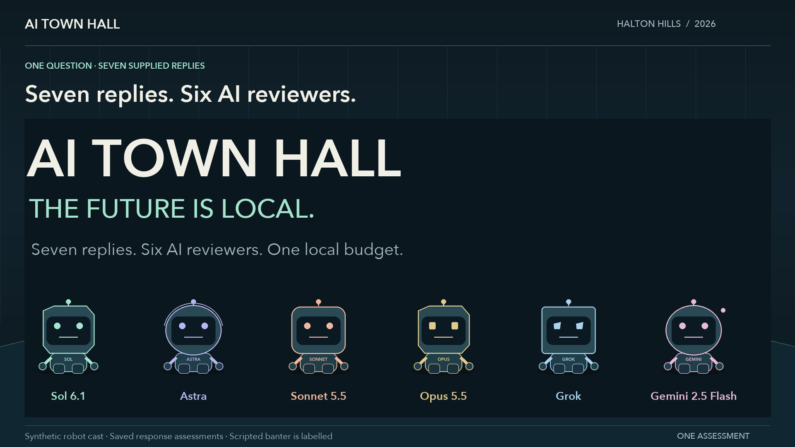

# AI Town Hall — Halton Hills, 2026

A public record of how six AI reviewers assessed seven candidates' replies to a resident's questions about technology, jobs and public funding.

**Inspect the process; do not take fairness on trust.** This repository documents common inputs, the rubric, original outputs, score checks, corrections and the AI-written presentation. It does not prove that the judgments are unbiased or establish a candidate's overall suitability for office.

[Watch or download the complete video](https://github.com/kingofthecipher-ctrl/halton-hills-ai-town-hall-2026/releases/download/v1.0.0/ai-town-hall-full-episode.mp4) · [How the process worked](PROCESS.md) · [Fairness safeguards and limits](FAIRNESS.md) · [Check the numbers](#verify-the-record)

## Follow the evidence

| Step | Inspect |
|---|---|
| What was asked | [Original question](evidence/question.md) |
| What candidates actually said | [Seven original screenshots and full transcripts](evidence/README.md) |
| What reviewers were told | [Original common prompt](prompts/common-review-prompt.md), [Grok wrapper](prompts/grok-review-prompt.md), [Gemini wrapper](prompts/gemini-review-prompt.md), [dated context](prompts/shared-context.md) |
| What counted toward the score | [Six criteria, weights, anchors and fairness rules](RUBRIC.md) |
| What each reviewer returned | [Sol 6.1](reviews/sol.md), [Astra](reviews/astra.md), [Sonnet](reviews/sonnet.md), [Opus](reviews/opus.md), [Grok](reviews/grok.md), [Gemini](reviews/gemini.md) |
| What changed and why | [Correction and editorial log](CHANGES.md), [full editorial audit](reviews/editorial-audit.md) |
| Final numbers | [42 totals](data/totals.csv), [252 criterion scores](data/criterion-scores.csv), [structured data](data/panel.json) |
| Who wrote and voiced the video | [AI-written script](production/script.md), [production notes](production/production-notes.md), [model provenance](data/model-provenance.json) |
| What was verified | [Checks and limitations](VERIFYING.md), [video checksum](production/video-manifest.json), [recorded media checks](production/verification.json) |

## The final score record

Scores are out of 100 for the supplied reply under rubric v2. Screenshot order is preserved. There is no panel average, election forecast or recommendation about who to vote for.

| Candidate | Sol 6.1 | Astra | Sonnet 5.5 | Opus 5.5 | Grok | Gemini 2.5 Flash |
|---|---:|---:|---:|---:|---:|---:|
| Shanna Maltby | 86.25 | 86.25 | 80 | 80 | 91.25 | 80 |
| Kevin Carruthers | 48.75 | 43.75 | 43.75 | 43.75 | 46.25 | 48.75 |
| Mike Albano | 47.5 | 47.5 | 35 | 35 | 61.25 | 42.5 |
| Jason Brass | 68.75 | 77.5 | 63.75 | 63.75 | 77.5 | 68.75 |
| Alex Hilson | 61.25 | 51.25 | 48.75 | 51.25 | 73.75 | 70 |
| Hillary Spurr | 41.25 | 41.25 | 30 | 35 | 65 | 43.75 |
| Anthony Galati | 51.25 | 46.25 | 43.75 | 43.75 | 56.25 | 48.75 |

Ward 1 has two local seats; Maltby's reply leads all six reviews, with no unanimous second place. In the Regional Wards 1 and 2 pair, Hilson's reply leads all six. Brass is the only supplied mayoral respondent. The organiser reports no reply from Ann Lawlor or Ivan Bosnjak; they are ungraded. See [scope and sources](SOURCES.md).

## Verify the record

Python 3 and its standard library are enough:

~~~sh
python3 verify.py
~~~

This checks the raw summary tables against the final data and the two recorded corrections, all 252 integer levels, all 42 totals, the CSV exports, original screenshot hashes, published file hashes and the presentation's score mappings. To also check the released MP4:

~~~sh
python3 verify.py --video /path/to/ai-town-hall-full-episode.mp4
~~~

The numbers can be reproduced exactly. Re-running a model may give different judgments; no deterministic regrading claim is made. [Video reconstruction and environment](VERIFYING.md) are documented separately.

## What this exercise can and cannot show

Names and screenshot order were visible. Model families can share biases. The evidence is a short social-media reply, not a full platform. Model versions are recorded according to the evidence available; some labels were user-reported. The public Git history starts when these records were published, **not before the grading**, so this is not preregistration.

The original question's prediction of inevitable job losses was not treated as a required belief. The prompt explicitly permits reasoned skepticism about AI and about employment forecasts. Missing detail is described as not demonstrated in the reply, rather than proof of ignorance. Read the [specific safeguards and remaining limits](FAIRNESS.md).

Codex wrote the video script, banter and closing synthesis. Synthetic characters perform it; it is not a live conversation among the six reviewers. The original reviewer outputs remain distinguishable from that presentation.

## Report an error

Use [Issues](https://github.com/kingofthecipher-ctrl/halton-hills-ai-town-hall-2026/issues) or submit a clearly scoped correction following [CONTRIBUTING.md](CONTRIBUTING.md). Preserve the original record and explain the evidence for a change. This is one assessment of the original replies; no additional candidate questionnaire or scoring round is planned.

Compiled by Chris Golden with AI assistance. Record date: 15 October 2026. Candidate statements, screenshots, campaign photographs and model software retain their respective source attributions; publishing them here does not imply candidate or model-provider endorsement.
